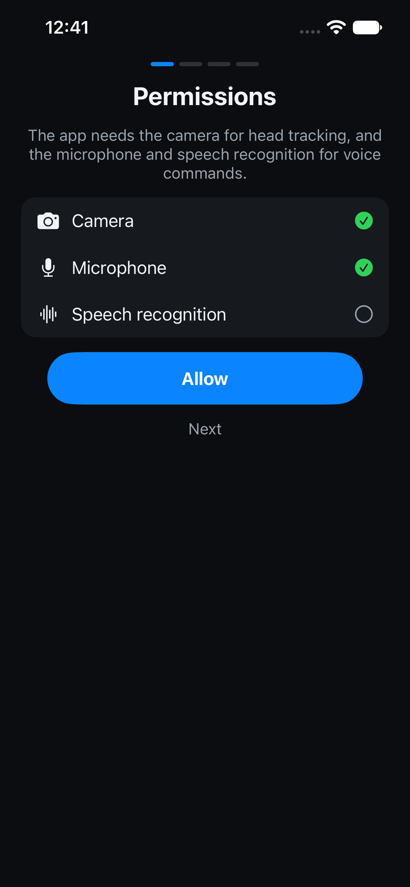
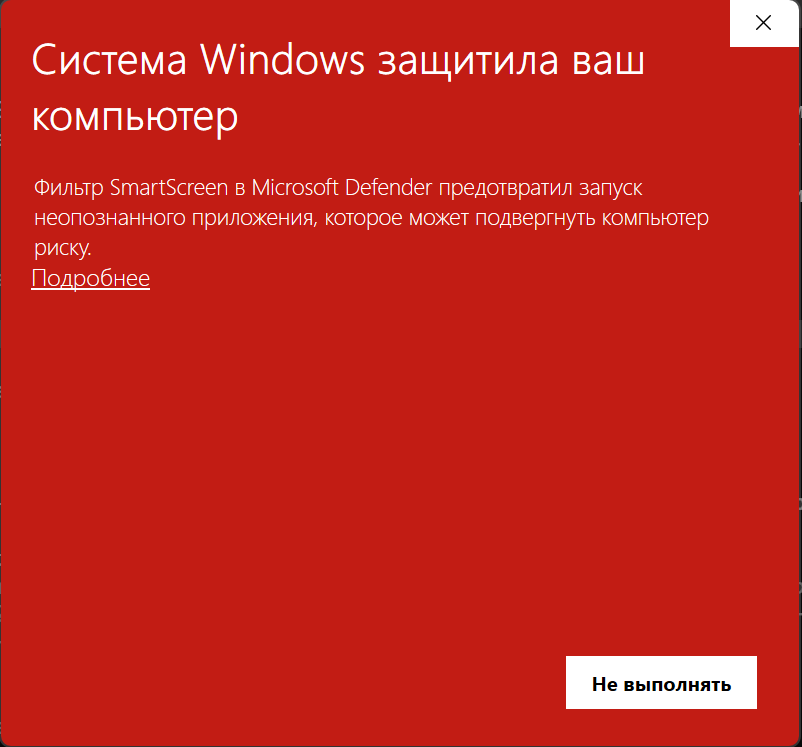
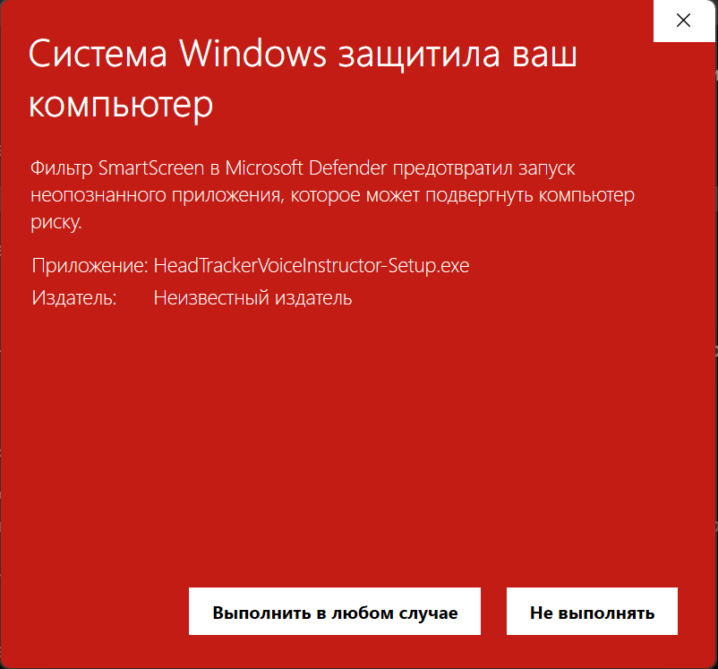
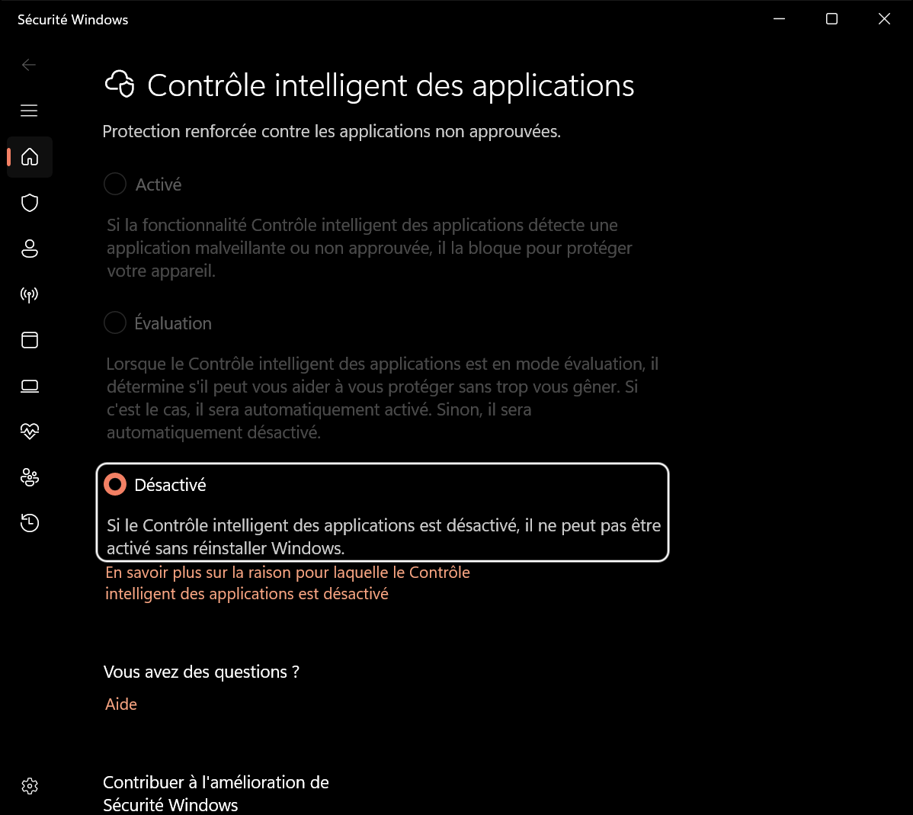
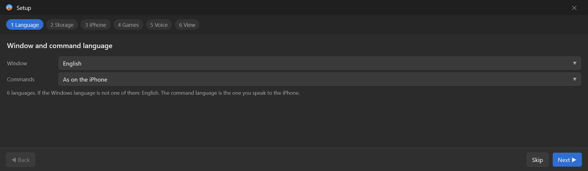
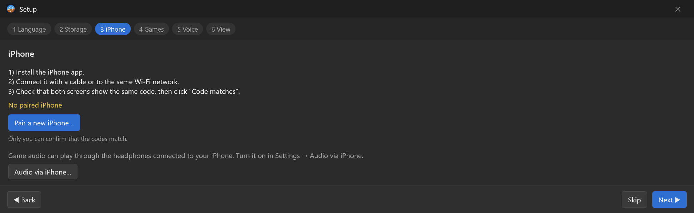
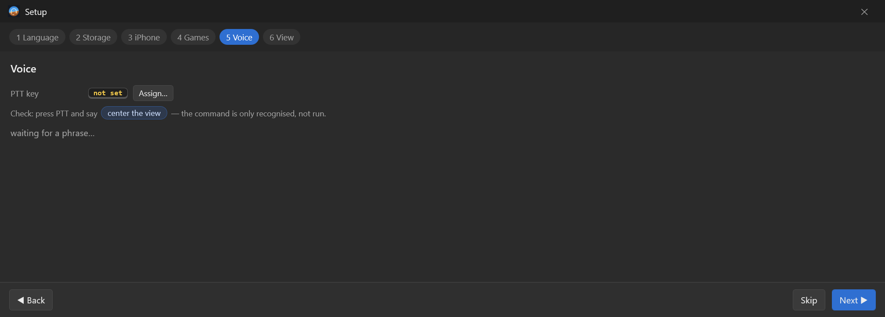
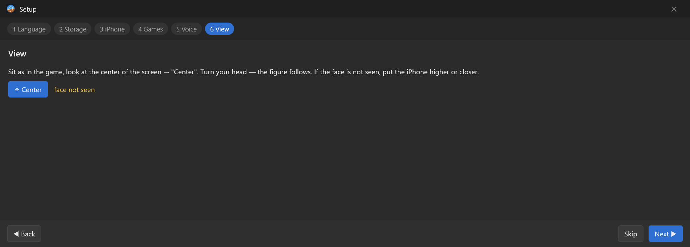
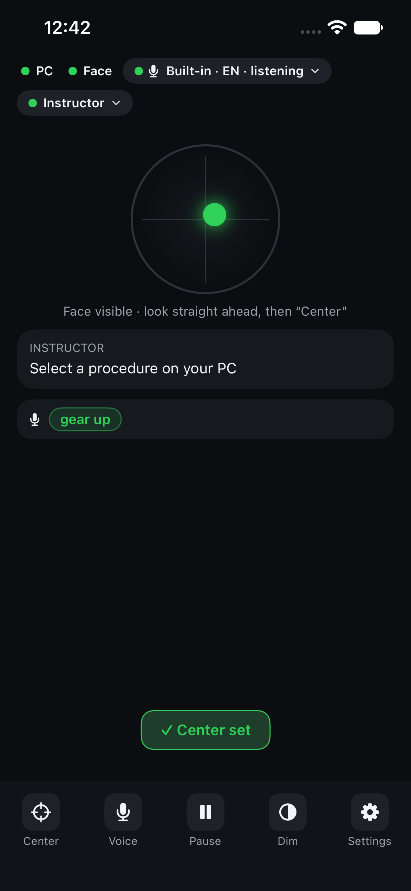

# Installation – von A bis Z

🌐 [English](install.en.md) · [Русский](install.ru.md) · [Français](install.fr.md) · Deutsch · [Italiano](install.it.md)

Zeitbedarf: etwa 15 Minuten. Sie brauchen: einen PC mit Windows 10 oder 11, ein iPhone mit Face ID (iPhone X oder neuer, iOS 16+), ein Kabel für das iPhone oder ein WLAN, in dem PC und iPhone beide sind.

Die Schritte unten beziehen sich auf Windows 11. In Windows 10 sehen die Fenster fast gleich aus; wo sie sich unterscheiden, steht es dabei.

---

## Teil 1 – Die iPhone-App

1. Öffnen Sie auf dem iPhone den **App Store** und suchen Sie nach **Head Tracker+Voice+Instructor**. Tippen Sie auf **Laden**.
   *Während der Testphase wird die App über Apples App **TestFlight** installiert: Der Entwickler schickt Ihnen eine Einladung; öffnen Sie sie auf dem iPhone und tippen Sie auf **Installieren**.*

2. Öffnen Sie die App. Eine kurze Einrichtung startet. Erlauben Sie den Zugriff, wenn iOS fragt:
   - **Kamera** – um Ihrem Kopf zu folgen;
   - **Mikrofon** und **Spracherkennung** – für Sprachbefehle.

3. Lassen Sie die App geöffnet. In Teil 3 kommen Sie darauf zurück, um sie mit dem PC zu koppeln.

---

## Teil 2 – Das Windows-Programm

### 2.1. Herunterladen

Laden Sie das Archiv des Programms über den Download-Link auf der Website herunter.

Der Browser meldet vielleicht, dass die Datei „nicht häufig heruntergeladen“ wird:
- **Microsoft Edge:** Zeigen Sie auf die Download-Zeile → **…** (Weitere Aktionen) → **Behalten**. Erscheint eine Frage: **Mehr anzeigen** → **Trotzdem behalten**.
- **Google Chrome:** Klicken Sie in der Download-Liste auf die Datei → **Unsichere Datei herunterladen** (oder **Behalten**).

### 2.2. Archiv zulassen – vor dem Entpacken

Tun Sie das **vor** dem Entpacken, sonst warnt Windows bei jeder Datei darin.

1. Klicken Sie mit der rechten Maustaste auf das Archiv → **Eigenschaften**.
2. Unten auf der Registerkarte **Allgemein**, neben „Die Datei stammt von einem anderen Computer…“, setzen Sie das Häkchen bei **Zulassen**.
3. Klicken Sie auf **OK**.

Gibt es kein Kontrollkästchen **Zulassen**, ist das Archiv schon zugelassen – machen Sie einfach weiter.

### 2.3. Entpacken

Klicken Sie mit der rechten Maustaste auf das Archiv → **Alle extrahieren…** → **Extrahieren**. Ein Ordner mit dem Setup-Programm öffnet sich. Starten Sie das Setup aus diesem Ordner, nicht aus dem Archiv heraus.

### 2.4. Setup starten: „Der Computer wurde durch Windows geschützt“

Doppelklicken Sie auf das Setup-Programm. Windows zeigt vielleicht ein blaues oder rotes Fenster **„Der Computer wurde durch Windows geschützt“**. Das ist normal: Das Programm ist noch nicht mit einem Herausgeberzertifikat signiert, deshalb kennt Windows den Herausgeber nicht.

1. Klicken Sie auf **Weitere Informationen** (den Link unter dem Text) – nicht auf **Nicht ausführen**.
2. Klicken Sie auf **Trotzdem ausführen**.

3. Wählen Sie die Sprache → klicken Sie auf **Installieren**. Administratorrechte sind nicht nötig.

### 2.5. Wenn es keine Schaltfläche „Trotzdem ausführen“ gibt (Windows 11, intelligente App-Steuerung)

Ist die **intelligente App-Steuerung** eingeschaltet, blockiert Windows 11 nicht signierte Programme, ohne „Trotzdem ausführen“ anzubieten. Die Entscheidung liegt bei Ihnen. Um das Programm zu installieren, können Sie sie ausschalten:

1. **Start** → **Windows-Sicherheit**.
2. **App- und Browsersteuerung**.
3. **Einstellungen für intelligente App-Steuerung**.
4. Wählen Sie **Aus** und bestätigen Sie.
5. Starten Sie das Setup erneut (Schritt 2.4).

Windows weist darauf hin: Ist die intelligente App-Steuerung einmal ausgeschaltet, lässt sie sich ohne Neuinstallation von Windows nicht wieder einschalten. Windows 10 hat diese Funktion nicht.

### 2.6. Wenn Microsoft Defender lange braucht oder die Datei entfernt

- Der erste Start kann bis zu einer Minute dauern, während Microsoft Defender die neue Datei prüft. Bitte warten Sie.
- Hat Defender die Datei unter Quarantäne gestellt, stellen Sie sie **nur dann wieder her, wenn Sie sie über den offiziellen Link heruntergeladen haben**: **Start** → **Windows-Sicherheit** → **Viren- & Bedrohungsschutz** → **Schutzverlauf** → Eintrag öffnen → **Aktionen** → **Wiederherstellen**.

---

## Teil 3 – Ersteinrichtung (Einrichtungshilfe)

Nach der Installation öffnet sich die Einrichtungshilfe von selbst. Jeden Schritt können Sie überspringen und später nachholen: **Hilfe → Einrichtungshilfe…**.

**Schritt 1 – Sprache.** Wählen Sie die Sprache der Fenster.

**Schritt 2 – Speicher.** Zeigt, wo das Programm seine Einstellungen ablegt. Meist müssen Sie nichts ändern → **Weiter**.

**Schritt 3 – iPhone.**
1. Öffnen Sie die App auf dem iPhone.
2. Schließen Sie das iPhone mit seinem Kabel an den PC an **oder** sorgen Sie dafür, dass beide im selben WLAN sind. Mit Kabel fragt das iPhone „Diesem Computer vertrauen?“ → **Vertrauen**.
3. Klicken Sie am PC auf **Neues iPhone koppeln…**.
4. Auf dem PC und auf dem iPhone erscheint derselbe Code. Vergleichen Sie beide. Sind sie gleich, klicken Sie am PC auf **Code stimmt** und bestätigen Sie auf dem iPhone. Sind sie verschieden, brechen Sie ab.
5. Ein Häkchen erscheint: Das iPhone ist gekoppelt. Es wird für das nächste Mal gespeichert.

Danach zeigt die Einrichtung der App auf dem iPhone, wo das Telefon hinkommt: vor Sie, mit Blick auf Ihr Gesicht, zum Beispiel auf einen kleinen Ständer unter oder neben dem Monitor.

**Schritt 4 – Spiele.** Das Programm findet die installierten Simulatoren von selbst. Warten Sie, bis die Liste geladen ist → **Weiter**.

**Schritt 5 – Stimme.** Weisen Sie die Sprechtaste (PTT, „Push to Talk“) zu: Klicken Sie auf **Zuweisen…** und drücken Sie eine Taste an Ihrem Joystick oder Schubhebel. Sagen Sie dann zum Testen **„Ansicht zentrieren“**.

**Schritt 6 – Ansicht.** Setzen Sie sich so hin wie sonst im Spiel und klicken Sie auf **Zentrieren**.

**Fertig.** Die Einrichtungshilfe schließt sich, und das Hauptfenster öffnet sich.

---

## Teil 4 – Der erste Flug

1. Starten Sie Ihren Simulator.
2. Wählen Sie im Hauptfenster den Simulator in der ersten Liste (läuft das Spiel schon, wird es meist von selbst erkannt).
3. Klicken Sie auf **Starten** (oder Strg+Alt+S).
4. Prüfen Sie: unten das grüne **LÄUFT** und im Bereich „Ansicht“ **Gesicht erkannt**.
5. Setzen Sie sich im Cockpit gerade hin und drücken Sie **Strg+Alt+C** (Zentrieren) – oder sagen Sie „Ansicht zentrieren“.

Nützliche Tasten:
| Taste | Aktion |
|---|---|
| Strg+Alt+S | Starten |
| Strg+Alt+C | Ansicht zentrieren |
| Strg+Alt+X | Pause (die Ansicht bleibt stehen, Sie können wegschauen) |
| Strg+Alt+P (halten) | Präzision: Kopfbewegungen werden verlangsamt, praktisch zum Zielen |

### Sprachbefehle
Stellen Sie auf dem iPhone unter **Einstellungen → Sprache der Spracheingabe** dieselbe Sprache ein wie die Befehlssprache im PC-Programm (**Einstellungen → Stimme**). Sprechen Sie kurz, wie ein Pilot: „Fahrwerk ausfahren“, „Landeklappen ausfahren“, „Landescheinwerfer an“. Die vollständige Liste für Ihr Spiel steht im Fenster **Befehle**.

### Der Instructor
Im Hauptfenster, Bereich „Instructor“: Wählen Sie das Flugzeug und den Flug (zum Beispiel **Ganzer Flug**) → **Starten**. Antworten Sie per Stimme: „erledigt“, „nächste Phase“, „noch einmal“, „Schritt überspringen“, „hilf mir“, „was jetzt“, „Training beenden“. Nach dem Flug: **Flüge → Flugbuch**.

---

## Aktualisieren
Schließen Sie das Programm (**Datei → Beenden**) und starten Sie das Setup der neuen Version. Ihre Einstellungen, Profile und die iPhone-Kopplung bleiben erhalten.

## Entfernen
**Windows-Einstellungen → Apps** → Head Tracker+Voice+Instructor → **Deinstallieren**. Das Programm bietet vorher an, alle Einstellungen in einer Datei zu speichern.

Probleme? Siehe [Fehlerbehebung](troubleshooting.de.md) oder [stellen Sie eine Frage](https://github.com/liaison-studio/htvi/issues/new/choose).
