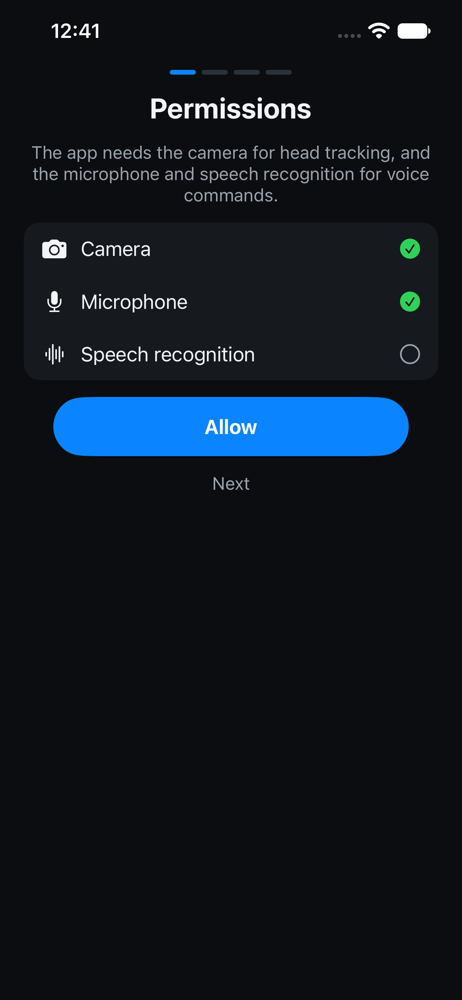
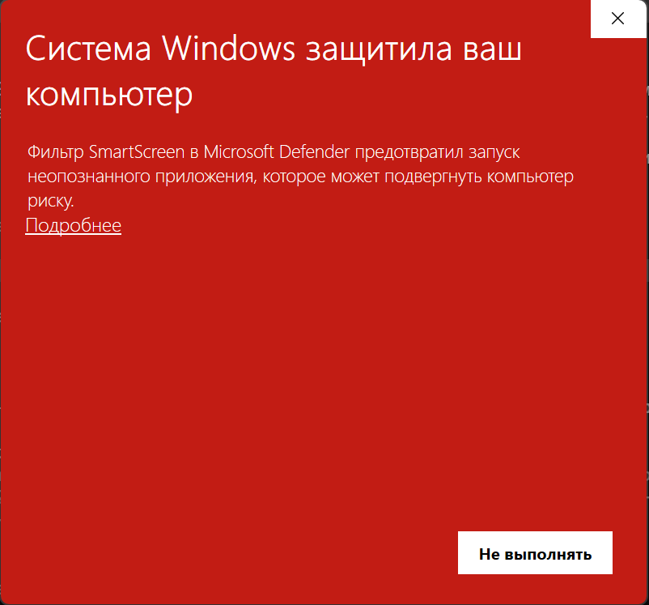
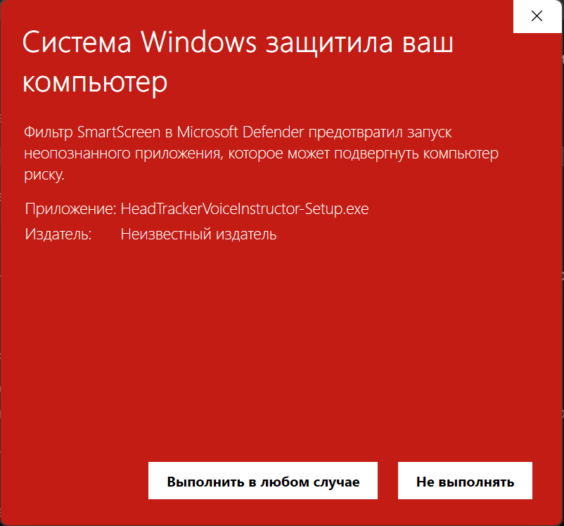
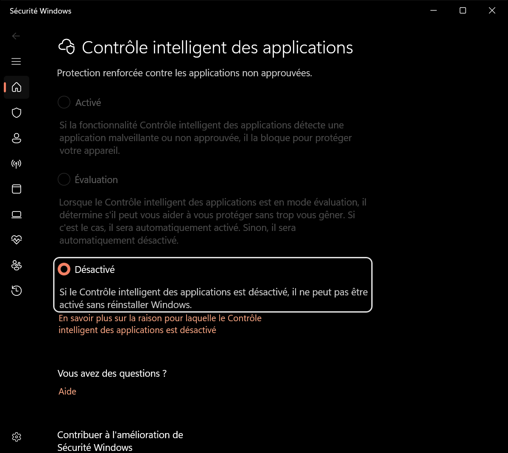
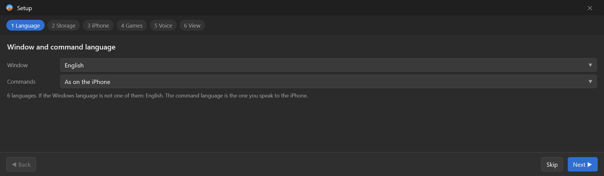
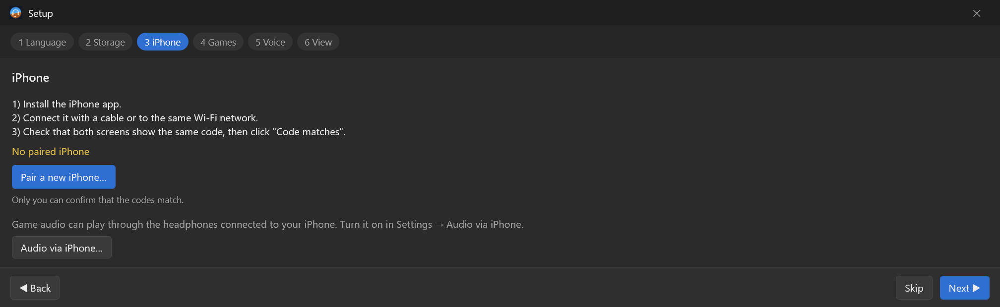
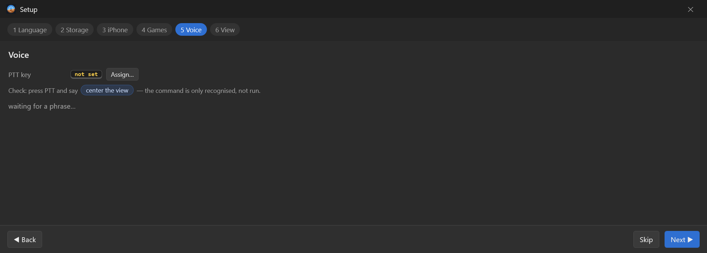
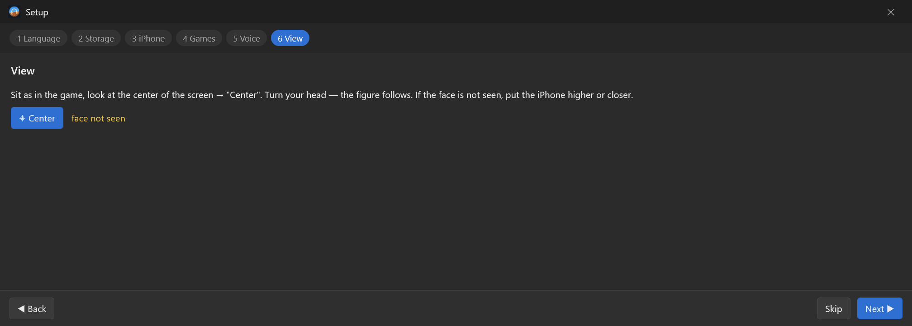
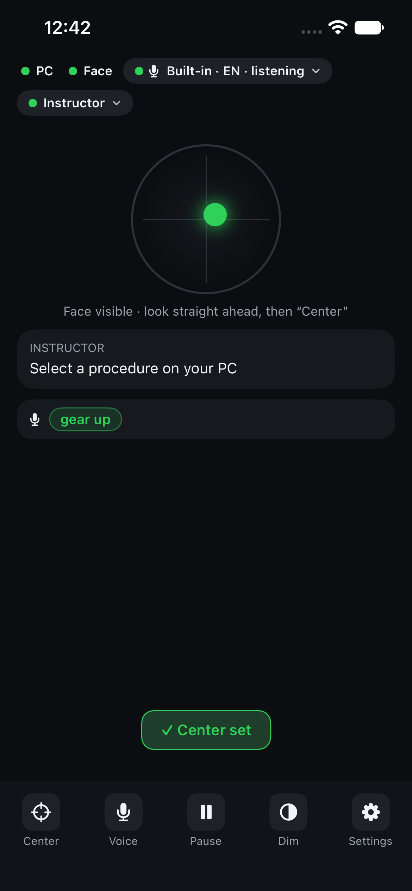

# Installation — from A to Z

🌐 English · [Русский](install.ru.md) · [Français](install.fr.md) · [Deutsch](install.de.md) · [Italiano](install.it.md)

Time needed: about 15 minutes. You need: a Windows 10 or 11 PC, an iPhone with Face ID (iPhone X or newer, iOS 16+), a cable for the iPhone or a Wi-Fi network shared by the PC and the iPhone.

The steps below are for Windows 11. In Windows 10 the windows look almost the same; where they differ, it is said.

---

## Part 1 — The iPhone app

1. On the iPhone, open the **App Store** and search for **Head Tracker+Voice+Instructor**. Tap **Get**.
   *During testing, the app is installed through Apple's **TestFlight** app: the developer sends you an invitation; open it on the iPhone and tap **Install**.*

2. Open the app. A short wizard starts. Allow access when iOS asks:
   - **Camera** — to follow your head;
   - **Microphone** and **Speech recognition** — for voice commands.

3. Leave the app open. You will come back to it in Part 3 to pair it with the PC.

---

## Part 2 — The Windows program

### 2.1. Download

Download the program's archive from the download link on the website.

The browser may say that the file "isn't commonly downloaded":
- **Microsoft Edge:** point at the download line → **…** (More actions) → **Keep**. If a question appears: **Show more** → **Keep anyway**.
- **Google Chrome:** in the downloads list, click the file → **Download unsafe file** (or **Keep**).

### 2.2. Unblock the archive — before extracting

Do this **before** extracting, or Windows will warn you about every file inside.

1. Right-click the archive → **Properties**.
2. At the bottom of the **General** tab, next to "This file came from another computer…", check **Unblock**.
3. Click **OK**.

If there is no **Unblock** check box, the archive is already unblocked — go on.

### 2.3. Extract

Right-click the archive → **Extract All…** → **Extract**. A folder opens with the setup program inside. Run the setup from this folder, not from inside the archive.

### 2.4. Run the setup — "Windows protected your PC"

Double-click the setup program. Windows may show a blue or red **"Windows protected your PC"** window. This is normal: the program is not yet signed with a publisher certificate, so Windows does not know the publisher.

1. Click **More info** (the link under the text) — not **Don't run**.
2. Click **Run anyway**.

3. Choose the language → click **Install**. Administrator rights are not needed.

### 2.5. If there is no "Run anyway" button (Windows 11, Smart App Control)

If **Smart App Control** is on, Windows 11 blocks unsigned programs without offering "Run anyway". The choice is yours. To install, you can turn it off:

1. **Start** → **Windows Security**.
2. **App & browser control**.
3. **Smart App Control settings**.
4. Choose **Off** and confirm.
5. Run the setup again (step 2.4).

Windows warns: once Smart App Control is off, it cannot be turned on again without reinstalling Windows. Windows 10 does not have this feature.

### 2.6. If Microsoft Defender takes long or removes the file

- The first start can take up to a minute while Microsoft Defender scans the new file. Wait.
- If Defender put the file in quarantine, restore it **only if you downloaded it from the official link**: **Start** → **Windows Security** → **Virus & threat protection** → **Protection history** → open the entry → **Actions** → **Restore**.

---

## Part 3 — First setup (wizard)

After installation, the setup wizard opens by itself. You can skip any step and come back later: **Help → How to set up…**.

**Step 1 — Language.** Choose the language of the windows.

**Step 2 — Data.** Shows where the program keeps its settings. Usually nothing to change → **Next**.

**Step 3 — iPhone.**
1. Open the app on the iPhone.
2. Plug the iPhone into the PC with its cable, **or** make sure both are on the same Wi-Fi network. With a cable, the iPhone asks "Trust this computer?" → **Trust**.
3. On the PC, click **Pair a new iPhone…**.
4. The same code appears on the PC and on the iPhone. Compare them. If they are identical, click **Code matches** on the PC and confirm on the iPhone. If they differ, cancel.
5. A check mark appears: the iPhone is paired. It is remembered for next time.

On the iPhone, the app's wizard then shows where to put the phone: in front of you, facing your face, for example on a small stand below or beside the monitor.

**Step 4 — Games.** The program finds the installed simulators by itself. Wait until the list has loaded → **Next**.

**Step 5 — Voice.** Assign the push-to-talk (PTT) button: click **Assign…** and press a button on your joystick or throttle. Then say **"center the view"** to test.

**Step 6 — View.** Sit as you usually sit in the game and click **Center**.

**Done.** The wizard closes and the main window opens.

---

## Part 4 — First flight

1. Start your simulator.
2. In the main window, choose the simulator in the first list (if the game is running, it is usually recognized by itself).
3. Click **Start** (or Ctrl+Alt+S).
4. Check: the green **RUNNING** label at the bottom, and **face visible** in the View block.
5. In the cockpit, sit straight and press **Ctrl+Alt+C** (Center) — or say "center the view".

Useful keys:
| Key | Action |
|---|---|
| Ctrl+Alt+S | Start |
| Ctrl+Alt+C | Center the view |
| Ctrl+Alt+X | Pause (the view freezes, you can look away) |
| Ctrl+Alt+P (hold) | Precision: head movements slowed down, handy for aiming |

### Voice commands
On the iPhone, set **Settings → Speech language** to the same language as the commands in the PC program (**Settings → Voice**). Speak briefly, like a pilot: "gear down", "flaps down", "landing lights on". The full list for your game is in the **Commands** window.

### The instructor
In the main window, Instructor block: choose the aircraft and the flight (for example **Whole flight**) → **Start**. Answer by voice: "done", "next phase", "repeat", "skip", "help", "what next", "stop training". After the flight: **Flights → Flight journal**.

---

## Updating
Close the program (**File → Exit**) and run the new version's setup. Your settings, profiles and iPhone pairing are kept.

## Removing
**Windows Settings → Apps** → Head Tracker+Voice+Instructor → **Uninstall**. The program offers to save all settings to a file first.

Problems? See [Troubleshooting](troubleshooting.en.md) or [ask a question](https://github.com/liaison-studio/htvi/issues/new/choose).
