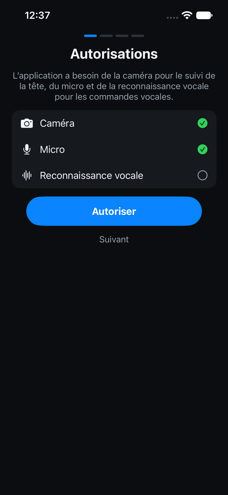
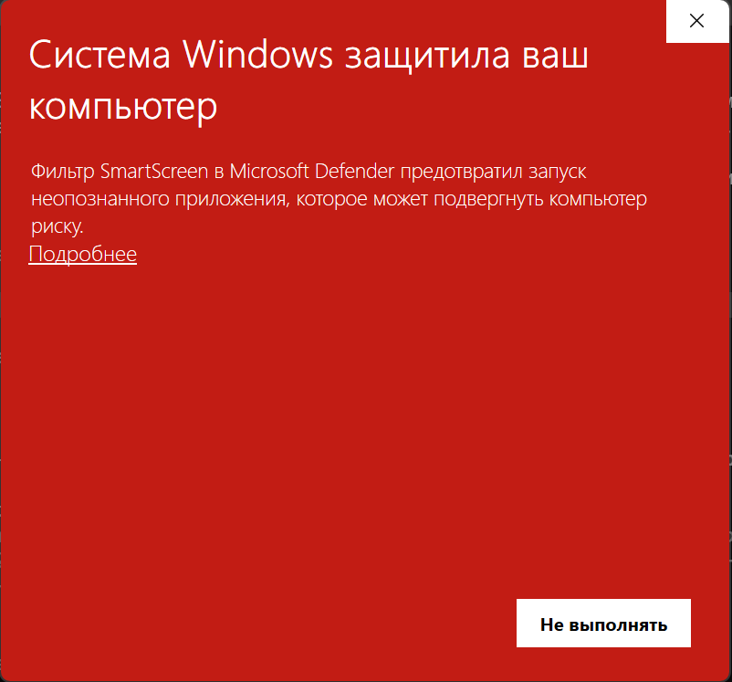
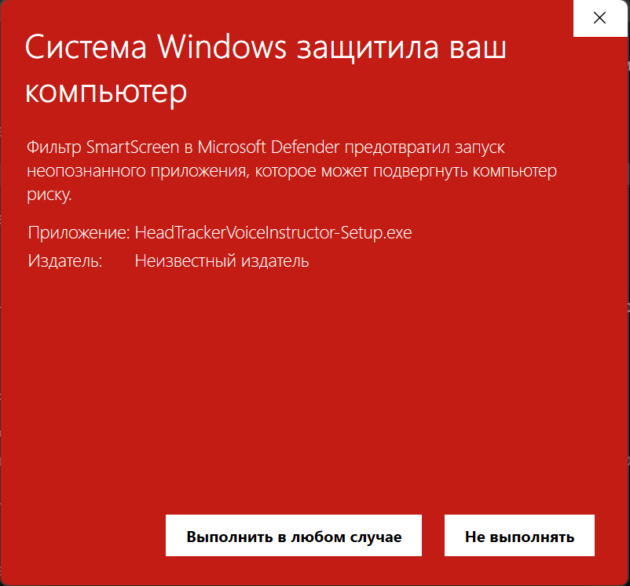
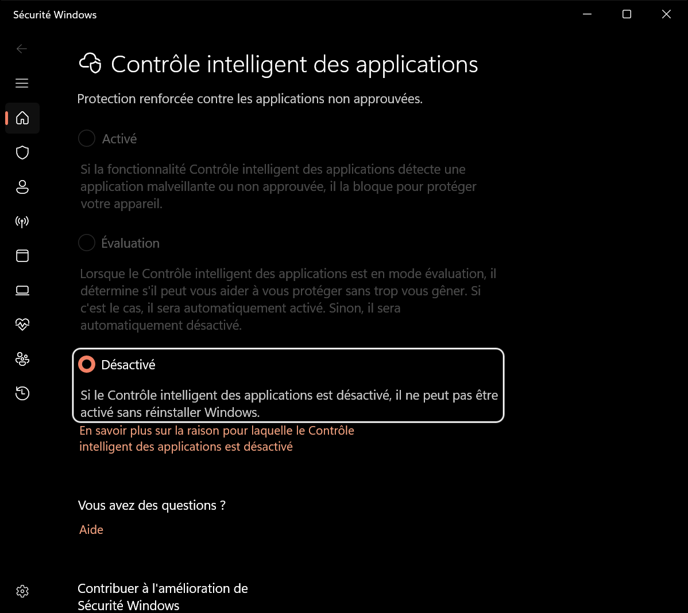
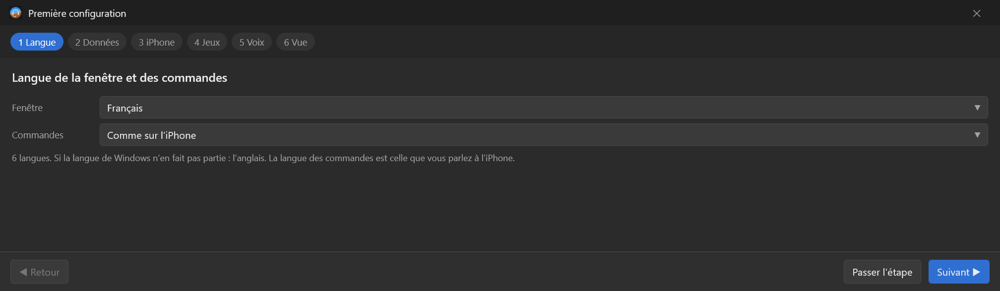
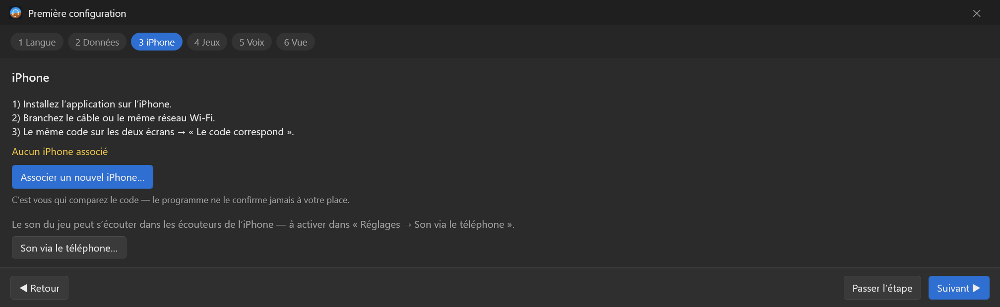
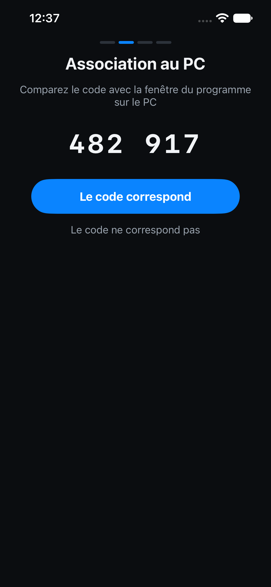
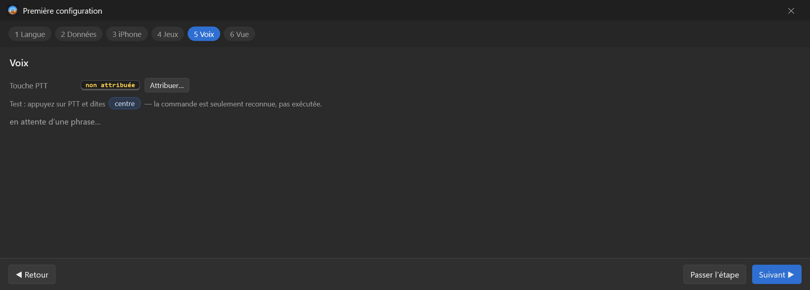
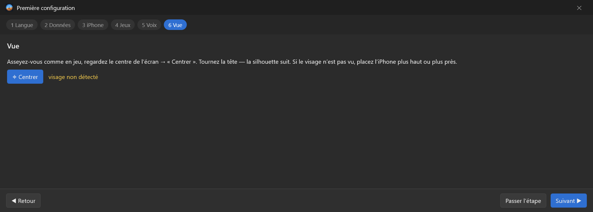
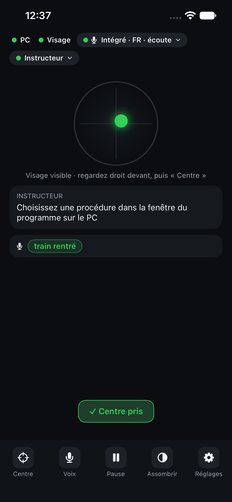

# Installation — de A à Z

🌐 [English](install.en.md) · [Русский](install.ru.md) · Français · [Deutsch](install.de.md) · [Italiano](install.it.md)

Durée : environ 15 minutes. Il vous faut : un PC sous Windows 10 ou 11, un iPhone avec Face ID (iPhone X ou plus récent, iOS 16 ou ultérieur), un câble pour l’iPhone ou un réseau Wi-Fi commun au PC et à l’iPhone.

Les étapes ci-dessous sont décrites pour Windows 11. Sous Windows 10, les fenêtres sont presque identiques ; les différences sont indiquées.

---

## Partie 1 — L’application iPhone

1. Sur l’iPhone, ouvrez l’**App Store** et recherchez **Head Tracker+Voice+Instructor**. Touchez **Obtenir**.
   *Pendant la phase de test, l’application s’installe via l’app **TestFlight** d’Apple : le développeur vous envoie une invitation ; ouvrez-la sur l’iPhone et touchez **Installer**.*

2. Ouvrez l’application. Un court assistant démarre. Autorisez l’accès quand iOS le demande :
   - **Appareil photo** — pour suivre votre tête ;
   - **Micro** et **Reconnaissance vocale** — pour les commandes vocales.

3. Laissez l’application ouverte. Vous y reviendrez à la partie 3 pour l’associer au PC.

---

## Partie 2 — Le programme Windows

### 2.1. Télécharger

Téléchargez l’archive du programme depuis le lien de téléchargement du site.

Le navigateur peut indiquer que le fichier « n’est pas téléchargé couramment » :
- **Microsoft Edge :** placez le pointeur sur la ligne du téléchargement → **…** (Autres actions) → **Conserver**. Si une question s’affiche : **Afficher plus** → **Conserver quand même**.
- **Google Chrome :** dans la liste des téléchargements, cliquez sur le fichier → **Télécharger le fichier non sécurisé** (ou **Conserver**).

### 2.2. Débloquer l’archive — avant l’extraction

Faites-le **avant** l’extraction, sinon Windows vous avertira pour chaque fichier qu’elle contient.

1. Cliquez avec le bouton droit sur l’archive → **Propriétés**.
2. En bas de l’onglet **Général**, à côté de « Ce fichier provient d’un autre ordinateur… », cochez **Débloquer**.
3. Cliquez sur **OK**.

Si la case **Débloquer** n’apparaît pas, l’archive est déjà débloquée : passez à la suite.

### 2.3. Extraire

Cliquez avec le bouton droit sur l’archive → **Extraire tout…** → **Extraire**. Un dossier s’ouvre avec le programme d’installation. Lancez l’installation depuis ce dossier, pas depuis l’intérieur de l’archive.

### 2.4. Lancer l’installation — Windows a protégé votre ordinateur

Double-cliquez sur le programme d’installation. Windows peut afficher une fenêtre bleue ou rouge **« Windows a protégé votre ordinateur »**. C’est normal : le programme n’est pas encore signé avec un certificat d’éditeur, Windows ne connaît donc pas l’éditeur.

1. Cliquez sur **Informations complémentaires** (le lien sous le texte) — et non sur **Ne pas exécuter**.
2. Cliquez sur **Exécuter quand même**.

3. Choisissez la langue → cliquez sur **Installer**. Les droits d’administrateur ne sont pas nécessaires.

### 2.5. S’il n’y a pas de bouton « Exécuter quand même » (Windows 11, Contrôle intelligent des applications)

Si le **Contrôle intelligent des applications** (Smart App Control) est activé, Windows 11 bloque les programmes non signés sans proposer « Exécuter quand même ». La décision vous appartient. Pour installer, vous pouvez le désactiver :

1. **Démarrer** → **Sécurité Windows**.
2. **Contrôle des applications et du navigateur**.
3. **Paramètres du Contrôle intelligent des applications**.
4. Choisissez **Désactivé** et confirmez.
5. Relancez l’installation (étape 2.4).

Windows vous prévient : une fois le Contrôle intelligent des applications désactivé, il ne peut plus être réactivé sans réinstaller Windows. Cette fonction n’existe pas sous Windows 10.

### 2.6. Si Microsoft Defender met du temps ou supprime le fichier

- Le premier lancement peut prendre jusqu’à une minute : Microsoft Defender analyse le nouveau fichier. Patientez.
- Si Defender a mis le fichier en quarantaine, restaurez-le **uniquement si vous l’avez téléchargé depuis le lien officiel** : **Démarrer** → **Sécurité Windows** → **Protection contre les virus et menaces** → **Historique de protection** → ouvrez l’entrée → **Actions** → **Restaurer**.

---

## Partie 3 — Première configuration (assistant)

Après l’installation, l’assistant de configuration s’ouvre tout seul. Vous pouvez passer n’importe quelle étape et y revenir plus tard : **Aide → Comment configurer…**.

**Étape 1 — Langue.** Choisissez la langue des fenêtres.

**Étape 2 — Données.** Indique où le programme garde ses réglages. En général, rien à changer → **Suivant**.

**Étape 3 — iPhone.**
1. Ouvrez l’application sur l’iPhone.
2. Branchez l’iPhone au PC avec son câble, **ou** vérifiez que les deux sont sur le même réseau Wi-Fi. Avec le câble, l’iPhone demande « Se fier à cet ordinateur ? » → **Se fier**.
3. Sur le PC, cliquez sur **Associer un nouvel iPhone…**.
4. Le même code s’affiche sur le PC et sur l’iPhone. Comparez-les. S’ils sont identiques, cliquez sur **Le code correspond** sur le PC et confirmez sur l’iPhone. S’ils sont différents, annulez.
5. Une coche apparaît : l’iPhone est associé. Il est mémorisé pour les fois suivantes.

Sur l’iPhone, l’assistant de l’application vous montre ensuite où poser le téléphone : devant vous, tourné vers votre visage, par exemple sur un petit support sous l’écran ou à côté.

**Étape 4 — Jeux.** Le programme trouve tout seul les simulateurs installés. Attendez que la liste soit chargée → **Suivant**.

**Étape 5 — Voix.** Attribuez le bouton « appuyer pour parler » (PTT) : cliquez sur **Attribuer…** et appuyez sur un bouton de votre joystick ou de votre manette des gaz. Dites ensuite **« recentrer la vue »** pour essayer.

**Étape 6 — Vue.** Asseyez-vous comme d’habitude en jeu et cliquez sur **Centrer**.

**Terminé.** L’assistant se ferme et la fenêtre principale s’ouvre.

---

## Partie 4 — Premier vol

1. Lancez votre simulateur.
2. Dans la fenêtre principale, choisissez le simulateur dans la première liste (si le jeu est lancé, il est en général reconnu tout seul).
3. Cliquez sur **Démarrer** (ou Ctrl+Alt+S).
4. Vérifiez : **EN MARCHE** en vert en bas, et **visage détecté** dans le bloc **Vue**.
5. Dans le cockpit, asseyez-vous bien droit et appuyez sur **Ctrl+Alt+C** (Centrer) — ou dites « recentrer la vue ».

Touches utiles :
| Touche | Action |
|---|---|
| Ctrl+Alt+S | Démarrer |
| Ctrl+Alt+C | Centrer la vue |
| Ctrl+Alt+X | Pause (la vue se fige, vous pouvez détourner la tête) |
| Ctrl+Alt+P (maintenir) | Précis : les mouvements de la tête sont ralentis, pratique pour viser |

### Commandes vocales
Sur l’iPhone, dans **Réglages → Langue de la parole**, choisissez la même langue que celle des commandes dans le programme du PC (**Réglages → Voix**). Parlez court, comme un pilote : « train sorti », « volets bas », « phares d’atterrissage allumés ». La liste complète pour votre jeu se trouve dans la fenêtre **Commandes**.

### L’instructeur
Dans la fenêtre principale, bloc **Instructeur** : choisissez l’avion et le vol (par exemple **Vol complet**) → **Démarrer**. Répondez à la voix : « c’est fait », « étape suivante », « répète », « passe cette étape », « aide-moi », « et ensuite », « arrête l’entraînement ». Après le vol : **Vols → Journal des vols**.

---

## Mise à jour
Fermez le programme (**Fichier → Quitter**) et lancez l’installation de la nouvelle version. Vos réglages, vos profils et l’association de l’iPhone sont conservés.

## Désinstallation
**Paramètres Windows → Applications** → Head Tracker+Voice+Instructor → **Désinstaller**. Le programme propose d’abord d’enregistrer tous les réglages dans un fichier.

Un problème ? Consultez le [Dépannage](troubleshooting.fr.md) ou [posez une question](https://github.com/liaison-studio/htvi/issues/new/choose).
