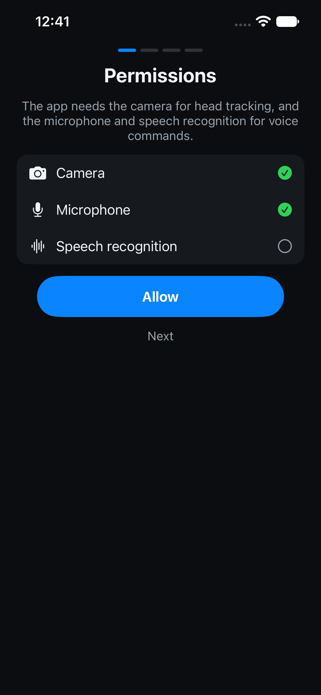
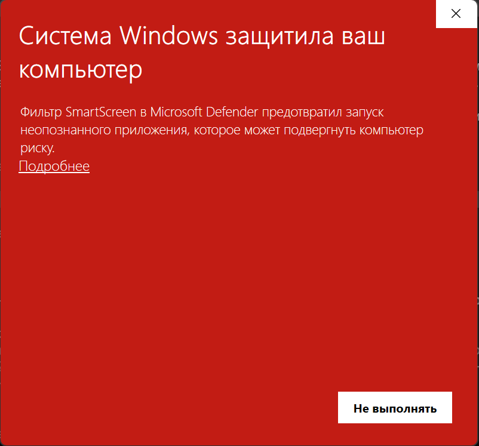
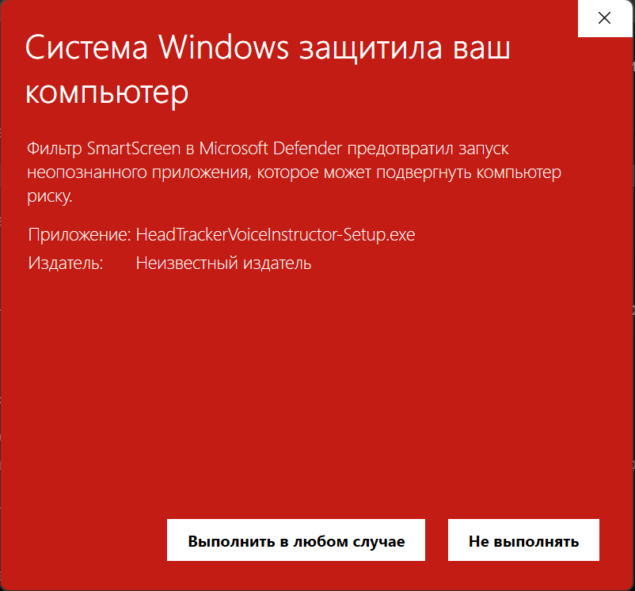
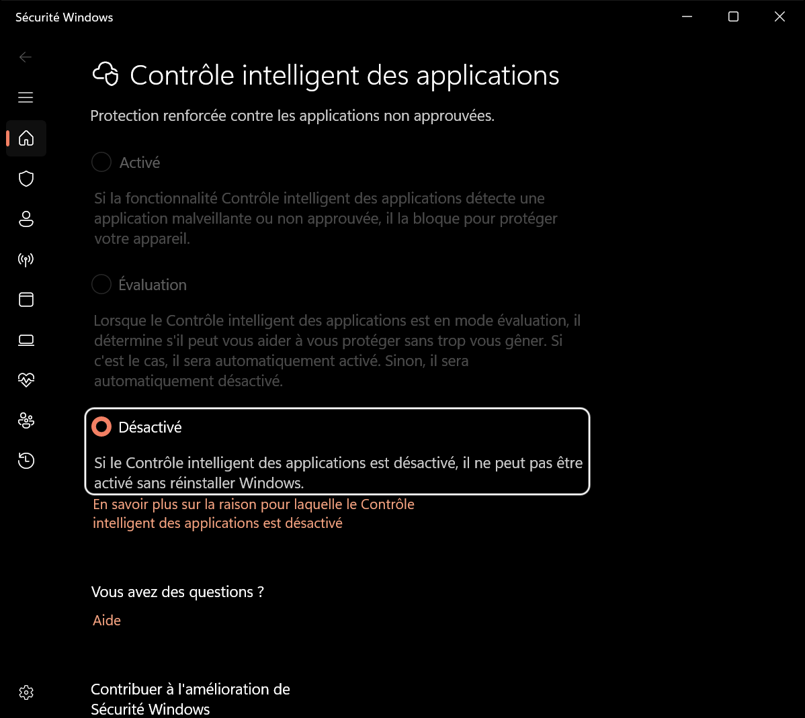
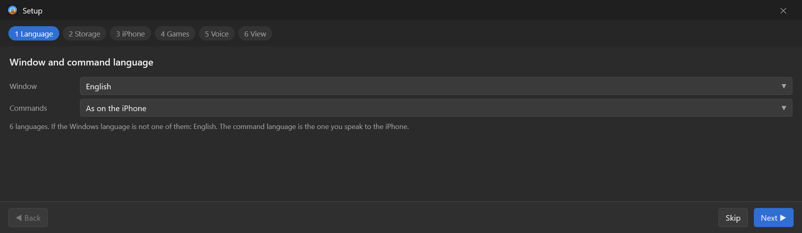
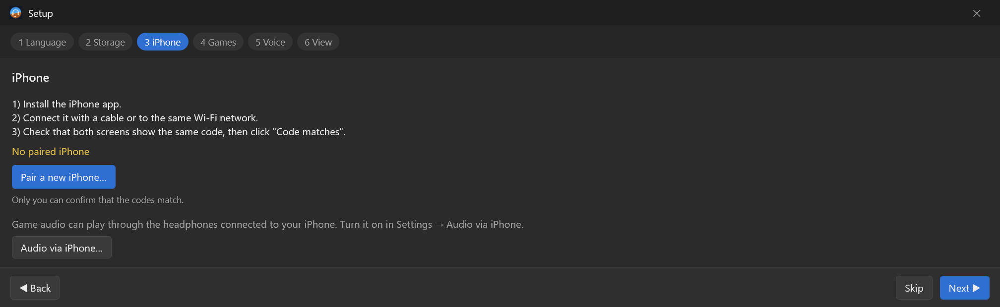
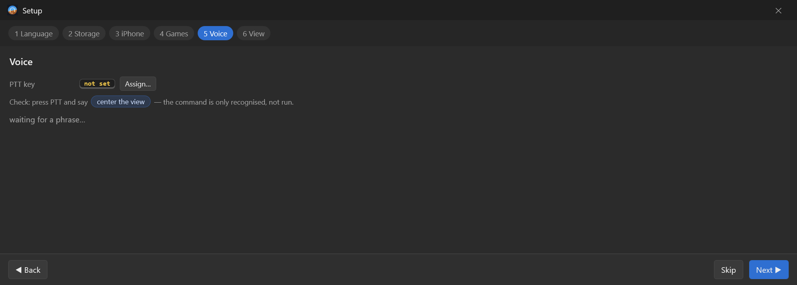
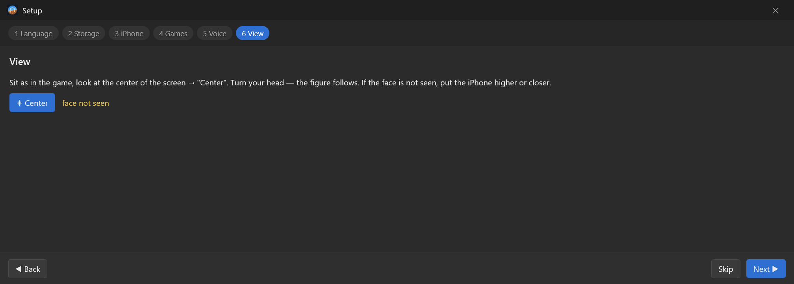
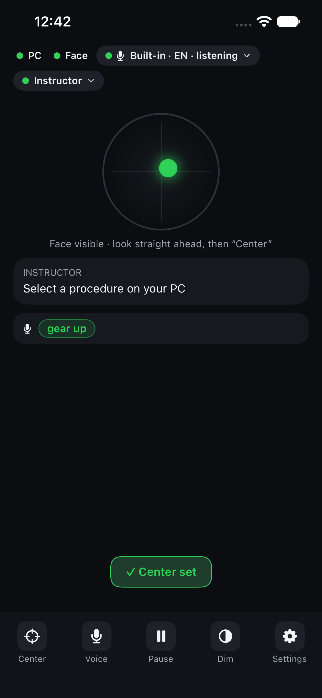

# Installazione — dall’inizio alla fine

🌐 [English](install.en.md) · [Русский](install.ru.md) · [Français](install.fr.md) · [Deutsch](install.de.md) · Italiano

Tempo necessario: circa 15 minuti. Ti servono: un PC con Windows 10 o 11, un iPhone con Face ID (iPhone X o più recente, iOS 16+), un cavo per l’iPhone oppure una rete Wi-Fi comune al PC e all’iPhone.

I passi qui sotto sono per Windows 11. In Windows 10 le finestre sono quasi uguali; dove cambiano, è indicato.

---

## Parte 1 — L’app per iPhone

1. Sull’iPhone apri l’**App Store** e cerca **Head Tracker+Voice+Instructor**. Tocca **Ottieni**.
   *Durante i test l’app si installa tramite l’app **TestFlight** di Apple: lo sviluppatore ti invia un invito; aprilo sull’iPhone e tocca **Installa**.*

2. Apri l’app. Parte una breve configurazione guidata. Quando iOS lo chiede, consenti l’accesso a:
   - **Fotocamera** — per seguire la tua testa;
   - **Microfono** e **Riconoscimento vocale** — per i comandi vocali.

3. Lascia l’app aperta. Ci tornerai nella Parte 3 per associarla al PC.

---

## Parte 2 — Il programma per Windows

### 2.1. Scarica

Scarica l’archivio del programma dal link di download sul sito.

Il browser può dire che il file «non viene scaricato comunemente»:
- **Microsoft Edge:** porta il puntatore sulla riga del download → **…** (Altre azioni) → **Mantieni**. Se compare una domanda: **Mostra altro** → **Mantieni comunque**.
- **Google Chrome:** nell’elenco dei download fai clic sul file → **Scarica file non sicuro** (oppure **Mantieni**).

### 2.2. Sblocca l’archivio — prima di estrarlo

Fallo **prima** di estrarlo, altrimenti Windows ti avviserà per ogni file al suo interno.

1. Fai clic con il tasto destro sull’archivio → **Proprietà**.
2. In fondo alla scheda **Generale**, accanto a «Il file proviene da un altro computer…», spunta **Sblocca**.
3. Fai clic su **OK**.

Se la casella **Sblocca** non c’è, l’archivio è già sbloccato: vai avanti.

### 2.3. Estrai

Fai clic con il tasto destro sull’archivio → **Estrai tutto…** → **Estrai**. Si apre una cartella con dentro il programma di installazione. Avvia l’installazione da questa cartella, non dall’interno dell’archivio.

### 2.4. Avvia l’installazione — «PC protetto da Windows»

Fai doppio clic sul programma di installazione. Windows può mostrare una finestra blu o rossa **«PC protetto da Windows»**. È normale: il programma non è ancora firmato con un certificato dell’autore, quindi Windows non conosce l’autore.

1. Fai clic su **Ulteriori informazioni** (il link sotto il testo), non su **Non eseguire**.
2. Fai clic su **Esegui comunque**.

3. Scegli la lingua → fai clic su **Installa**. Non servono i diritti di amministratore.

### 2.5. Se il pulsante «Esegui comunque» non c’è (Windows 11, Controllo intelligente delle app)

Se il **Controllo intelligente delle app** (Smart App Control) è attivo, Windows 11 blocca i programmi non firmati senza proporre «Esegui comunque». La scelta è tua. Per installare il programma puoi disattivarlo:

1. **Start** → **Sicurezza di Windows**.
2. **Controllo app e browser**.
3. **Impostazioni di Controllo intelligente delle app**.
4. Scegli **Disattivato** e conferma.
5. Avvia di nuovo l’installazione (passo 2.4).

Windows avvisa: una volta disattivato, il Controllo intelligente delle app non può essere riattivato senza reinstallare Windows. In Windows 10 questa funzione non c’è.

### 2.6. Se Microsoft Defender ci mette molto o rimuove il file

- Il primo avvio può richiedere fino a un minuto, mentre Microsoft Defender controlla il nuovo file. Aspetta.
- Se Defender ha messo il file in quarantena, ripristinalo **solo se l’hai scaricato dal link ufficiale**: **Start** → **Sicurezza di Windows** → **Protezione da virus e minacce** → **Cronologia protezione** → apri la voce → **Azioni** → **Ripristina**.

---

## Parte 3 — Prima configurazione (procedura guidata)

Dopo l’installazione la configurazione guidata si apre da sola. Puoi saltare qualsiasi passo e tornarci più tardi: **Aiuto → Come configurare…**.

**Passo 1 — Lingua.** Scegli la lingua delle finestre.

**Passo 2 — Dati.** Mostra dove il programma conserva le impostazioni. Di solito non c’è niente da cambiare → **Avanti**.

**Passo 3 — iPhone.**
1. Apri l’app sull’iPhone.
2. Collega l’iPhone al PC con il suo cavo, **oppure** verifica che entrambi siano sulla stessa rete Wi-Fi. Con il cavo, l’iPhone chiede «Autorizzare questo computer?» → **Autorizza**.
3. Sul PC fai clic su **Associa un nuovo iPhone…**.
4. Sul PC e sull’iPhone compare lo stesso codice. Confrontali. Se sono identici, fai clic su **Il codice corrisponde** sul PC e conferma sull’iPhone. Se sono diversi, annulla.
5. Compare un segno di spunta: l’iPhone è associato. Viene ricordato per le volte successive.

Poi, sull’iPhone, la configurazione dell’app mostra dove mettere il telefono: davanti a te, rivolto verso il tuo viso, per esempio su un piccolo supporto sotto o accanto al monitor.

**Passo 4 — Giochi.** Il programma trova da solo i simulatori installati. Aspetta che l’elenco sia caricato → **Avanti**.

**Passo 5 — Voce.** Assegna il tasto PTT (push-to-talk, premi per parlare): fai clic su **Assegna…** e premi un pulsante del joystick o della manetta. Poi di’ **«centra la vista»** per provare.

**Passo 6 — Visuale.** Siediti come fai di solito nel gioco e fai clic su **Centra**.

**Fatto.** La configurazione si chiude e si apre la finestra principale.

---

## Parte 4 — Il primo volo

1. Avvia il simulatore.
2. Nella finestra principale scegli il simulatore nel primo elenco (se il gioco è già avviato, di solito viene riconosciuto da solo).
3. Fai clic su **Avvia** (oppure Ctrl+Alt+S).
4. Controlla: in basso la scritta verde **IN FUNZIONE** e, nel riquadro Visuale, **volto visibile**.
5. Nel cockpit siediti dritto e premi **Ctrl+Alt+C** (Centra) — oppure di’ «centra la vista».

Tasti utili:
| Tasto | Azione |
|---|---|
| Ctrl+Alt+S | Avvia |
| Ctrl+Alt+C | Centra la visuale |
| Ctrl+Alt+X | Pausa (la visuale si ferma, puoi guardare altrove) |
| Ctrl+Alt+P (tieni premuto) | Precisione: i movimenti della testa vengono rallentati, comodo per mirare |

### Comandi vocali
Sull’iPhone imposta **Impostazioni → Lingua del parlato** sulla stessa lingua dei comandi del programma per PC (**Impostazioni → Voce**). Parla in modo breve, come un pilota: «carrello giù», «flap giù», «luci di atterraggio accese». L’elenco completo per il tuo gioco è nella finestra **Comandi**.

### L’istruttore
Nella finestra principale, riquadro Istruttore: scegli l’aereo e il volo (per esempio **Volo completo**) → **Avvia**. Rispondi a voce: «fatto», «fase successiva», «ripeti per favore», «salta il passo», «mi serve aiuto», «e adesso», «termina l’addestramento». Dopo il volo: **Voli → Registro dei voli**.

---

## Aggiornare
Chiudi il programma (**File → Esci**) e avvia l’installazione della nuova versione. Impostazioni, profili e associazione dell’iPhone restano.

## Disinstallare
**Impostazioni di Windows → App** → Head Tracker+Voice+Instructor → **Disinstalla**. Prima il programma propone di salvare tutte le impostazioni in un file.

Problemi? Vedi [Risoluzione dei problemi](troubleshooting.it.md) oppure [fai una domanda](https://github.com/liaison-studio/htvi/issues/new/choose).
