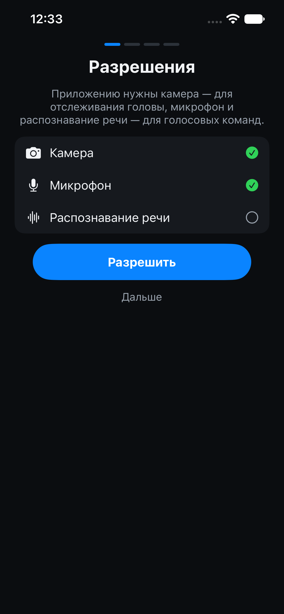
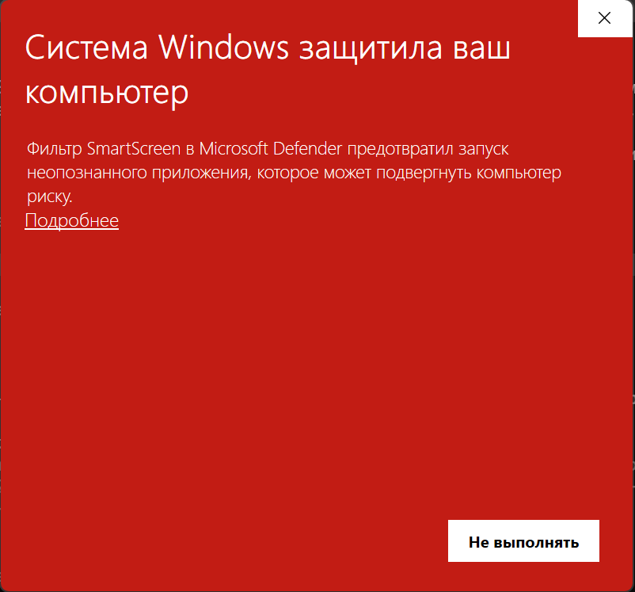
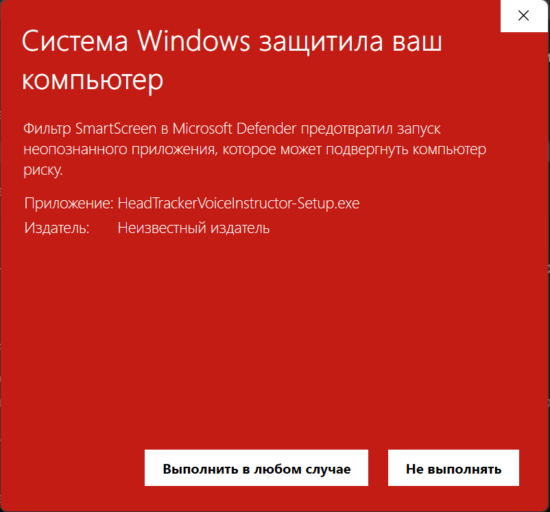
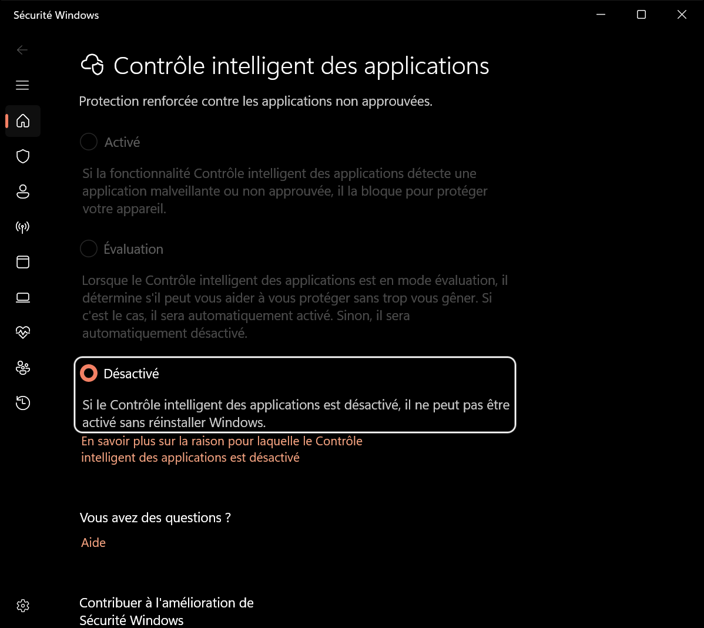
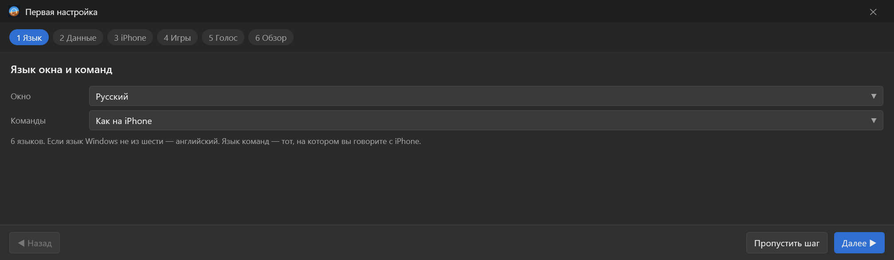
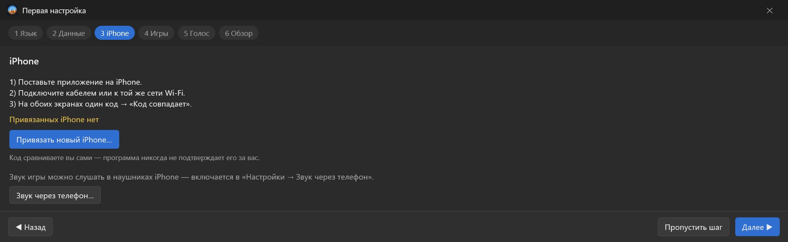
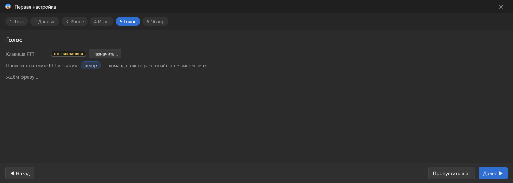
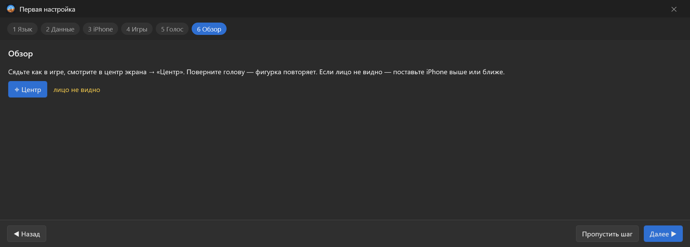
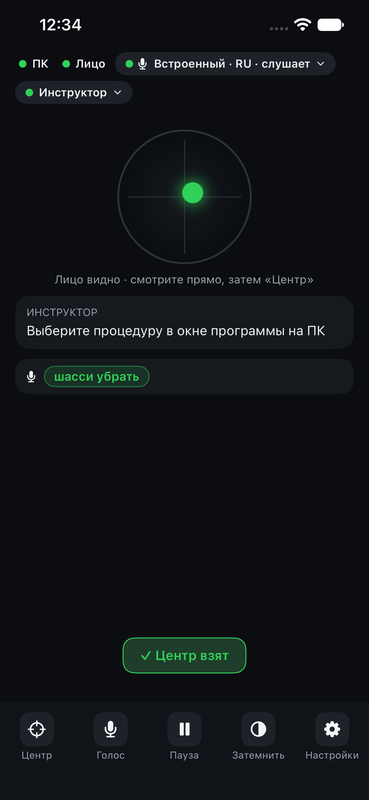

# Установка — от А до Я

🌐 [English](install.en.md) · **Русский** · [Français](install.fr.md) · [Deutsch](install.de.md) · [Italiano](install.it.md)

Сколько времени: около 15 минут. Что нужно: компьютер с Windows 10 или 11, iPhone с Face ID (iPhone X и новее, iOS 16+), кабель для iPhone или одна сеть Wi-Fi для компьютера и iPhone.

Шаги ниже — для Windows 11. В Windows 10 окна почти такие же; где отличаются — сказано.

---

## Часть 1 — Приложение на iPhone

1. На iPhone откройте **App Store** и найдите **Head Tracker+Voice+Instructor**. Нажмите **«Загрузить»**.
   *На время тестирования приложение ставится через приложение Apple **TestFlight**: разработчик присылает вам приглашение — откройте его на iPhone и нажмите **«Установить»**.*

2. Откройте приложение. Запустится короткий мастер. Когда iOS спросит, разрешите доступ:
   - **Камера** — чтобы следить за головой;
   - **Микрофон** и **Распознавание речи** — для голосовых команд.

3. Не закрывайте приложение. Вы вернётесь к нему в части 3, чтобы привязать его к компьютеру.

---

## Часть 2 — Программа для Windows

### 2.1. Скачать

Скачайте архив программы по ссылке для загрузки на сайте.

Браузер может написать, что файл «обычно не скачивается»:
- **Microsoft Edge:** наведите указатель на строку загрузки → **«…»** (Другие действия) → **«Сохранить»**. Если появится вопрос — **«Показать больше»** → **«Всё равно сохранить»**.
- **Google Chrome:** в списке загрузок нажмите на файл → **«Скачать небезопасный файл»** (или **«Сохранить»**).

### 2.2. Разблокировать архив — до распаковки

Сделайте это **до** распаковки, иначе Windows будет предупреждать о каждом файле внутри.

1. Щёлкните архив правой кнопкой → **«Свойства»**.
2. Внизу вкладки **«Общие»**, рядом с надписью «Этот файл получен с другого компьютера…», поставьте галочку **«Разблокировать»**.
3. Нажмите **«ОК»**.

Если галочки **«Разблокировать»** нет — архив уже разблокирован, переходите дальше.

### 2.3. Распаковать

Щёлкните архив правой кнопкой → **«Извлечь все…»** → **«Извлечь»**. Откроется папка, в ней — установщик. Запускайте установщик из этой папки, а не из окна архива.

### 2.4. Запуск установщика — «Система Windows защитила ваш компьютер»

Дважды щёлкните установщик. Windows может показать синее или красное окно **«Система Windows защитила ваш компьютер»**. Это нормально: программа пока не подписана сертификатом издателя, поэтому Windows не знает издателя.

1. Нажмите **«Подробнее»** (ссылка под текстом), а не **«Не выполнять»**.
2. Нажмите **«Выполнить в любом случае»**.

3. Выберите язык → нажмите **«Установить»**. Права администратора не нужны.

### 2.5. Если кнопки «Выполнить в любом случае» нет (Windows 11, интеллектуальное управление приложениями)

Если включено **«Интеллектуальное управление приложениями»** (Smart App Control), Windows 11 блокирует неподписанные программы и не предлагает «Выполнить в любом случае». Решение — за вами. Чтобы установить программу, его можно отключить:

1. **«Пуск»** → **«Безопасность Windows»**.
2. **«Управление приложениями/браузером»**.
3. **«Параметры интеллектуального управления приложениями»**.
4. Выберите **«Выкл.»** и подтвердите.
5. Снова запустите установщик (шаг 2.4).

Windows предупреждает: после отключения интеллектуальное управление приложениями нельзя снова включить без переустановки Windows. В Windows 10 этой функции нет.

### 2.6. Если Защитник Windows долго проверяет файл или удалил его

- Первый запуск может занять до минуты: Защитник Windows проверяет новый файл. Подождите.
- Если Защитник поместил файл в карантин, восстанавливайте его **только если вы скачали его по официальной ссылке**: **«Пуск»** → **«Безопасность Windows»** → **«Защита от вирусов и угроз»** → **«Журнал защиты»** → откройте запись → **«Действия»** → **«Восстановить»**.

---

## Часть 3 — Первая настройка (мастер)

После установки мастер настройки открывается сам. Любой шаг можно пропустить и пройти позже: **«Справка → Как настроить…»**.

**Шаг 1. Язык.** Выберите язык окон.

**Шаг 2. Данные.** Здесь видно, где программа хранит настройки. Обычно ничего менять не нужно → **«Далее»**.

**Шаг 3. iPhone.**
1. Откройте приложение на iPhone.
2. Подключите iPhone к компьютеру кабелем **или** убедитесь, что оба в одной сети Wi-Fi. При подключении кабелем iPhone спросит «Доверять этому компьютеру?» → **«Доверять»**.
3. На компьютере нажмите **«Привязать новый iPhone…»**.
4. На компьютере и на iPhone появится один и тот же код. Сравните их. Если они одинаковые, нажмите на компьютере **«Код совпадает»** и подтвердите на iPhone. Если разные — отмените.
5. Появится галочка: iPhone привязан. Программа запомнит его на следующий раз.

Затем мастер приложения на iPhone подскажет, куда поставить телефон: перед собой, камерой к лицу — например, на небольшую подставку под монитором или сбоку от него.

**Шаг 4. Игры.** Программа сама находит установленные симуляторы. Дождитесь, пока список загрузится → **«Далее»**.

**Шаг 5. Голос.** Назначьте кнопку PTT («нажми и говори»): нажмите **«Назначить…»** и нажмите кнопку на джойстике или РУДе. Затем для проверки скажите **«центр вида»**.

**Шаг 6. Обзор.** Сядьте так, как обычно сидите в игре, и нажмите **«Центр»**.

**Готово.** Мастер закрывается, открывается главное окно.

---

## Часть 4 — Первый полёт

1. Запустите симулятор.
2. В главном окне выберите симулятор в первом списке (если игра уже запущена, программа обычно узнаёт её сама).
3. Нажмите **«Запустить»** (или Ctrl+Alt+S).
4. Проверьте: внизу горит зелёное **«ИДЁТ»**, а в блоке «Обзор» — **«лицо видно»**.
5. В кабине сядьте прямо и нажмите **Ctrl+Alt+C** (центр) — или скажите «центр вида».

Полезные клавиши:
| Клавиши | Действие |
|---|---|
| Ctrl+Alt+S | Запустить |
| Ctrl+Alt+C | Центр вида |
| Ctrl+Alt+X | Пауза (вид замирает, можно отвернуться) |
| Ctrl+Alt+P (держать) | Точно: движения головы медленнее, удобно прицеливаться |

### Голосовые команды
На iPhone в **«Настройки» → «Язык речи»** выберите тот же язык, что и язык команд в программе на компьютере (**«Настройки → Голос»**). Говорите коротко, как пилот: «шасси выпустить», «закрылки выпустить», «фары включить». Полный список для вашей игры — в окне **«Команды»**.

### Инструктор
В главном окне, в блоке «Инструктор», выберите самолёт и полёт (например, **«Полёт целиком»**) → **«Начать»**. Отвечайте голосом: «готово», «дальше», «повтори», «пропусти», «подсказка», «что дальше», «закончить». После полёта: **«Полёты → Журнал полётов»**.

---

## Обновление
Закройте программу (**«Файл → Выход»**) и запустите установщик новой версии. Настройки, профили и привязка iPhone сохранятся.

## Удаление
**«Параметры Windows» → «Приложения»** → Head Tracker+Voice+Instructor → **«Удалить»**. Программа сначала предложит сохранить все настройки в файл.

Проблемы? См. [Решение проблем](troubleshooting.ru.md) или [задайте вопрос](https://github.com/liaison-studio/htvi/issues/new/choose).
